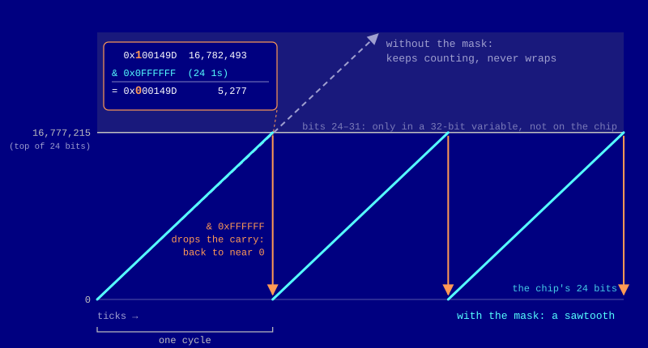

+++
author = "Yiğit Kolat"
title = "Notes around SIDOsc (0)"
date = "2026-11-06"
description = "The phase accumulator: the counter at the heart of every SID voice"
type = "posts"
draft = false
tags = []
+++

 

## DRAMATIS PERSONAE

 

- `The SID.` The Commodore 64's sound chip, the MOS Technology 6581 (later revised as the 8580). SID stands for Sound Interface Device. It was designed by Bob Yannes and has three independent voices, each with its own accumulator, frequency register and waveforms. Everything below happens inside one voice.
- `reSID.` A cycle-accurate software emulation of the SID, written in C++ by Dag Lem and used by emulators such as VICE. The code excerpts in this post come from reSID.
- `SIDOsc.` My SuperCollider UGen built on reSID ([github](https://github.com/hayakzan/SIDOsc)). It puts a SID voice inside SuperCollider, so its accumulator, frequency and waveforms can be controlled live and combined with other UGens. 
- `The system clock.` The Commodore 64's heartbeat, ticking about a million times a second (985,248 on a PAL machine, 1,022,727 on NTSC). Every **tick** below is one of these.
- `The phase accumulator.` A 24-bit counter, one per voice. It holds a value from 0 to 16,777,215, and when it goes past the top, it wraps around. This is the dial in the first widget below.
- `The frequency register.` A 16-bit number (0 to 65,535) that the program writes for each voice. It's the **step size**: on every tick, the SID adds it to the accumulator. It's the main thing a C64 musician changes to set the pitch.
- `The waveforms.` Sawtooth, triangle, pulse and noise. All four are read from the accumulator's upper bits, so there's no separate oscillator for each.
- `The pulse width register.` A 12-bit threshold that only the pulse waveform uses. More details is in ...

 

## Accumulating the phases

 

Every sound a SID voice makes comes out of one counter called the **phase accumulator**. Its pitch, all four of its waveforms, and even the tricks voices play on each other stem from this.

Let's say we have a dial numbered 0 to 63. On every tick, the hand jumps forward by a fixed amount, the **step**. When it passes 63, it wraps back around past 0 and keeps going. Each trip around the dial is one cycle of the waveform.

 

Try a step of 4. The hand needs 16 ticks to get around, so one cycle is 16 ticks long. A step of 8 gets around in 8 ticks, twice as fast, an octave higher. A bigger step means the counter wraps sooner, and wrapping sooner means a higher pitch. On the SID, that step is the `frequency register`. The program never sets a pitch directly. It sets how far the counter moves on each tick, and the pitch follows.

Note that the timbre is rougher than a smooth sawtooth. That’s because the toy counter has only 64 values (6 bits) and changes only 3,520 times a second. The SID’s sawtooth has 4,096 levels (the upper 12 bits of its 24-bit counter, more on this later) and updates about a million times a second. 

The real counter counts from 0 up to 16,777,215 before it wraps. On every tick of the system clock, the SID adds the frequency register to it. From the reSID source:
    
    accumulator += freq;
    accumulator &= 0xffffff;
    
 

Why the AND operation? On the chip, the counter is exactly 24 bits wide, so the carry out of the top bit simply falls off and the count wraps by itself. reSID, though, runs on an ordinary computer, where the accumulator lives in a 32-bit variable that would happily keep counting past 16,777,215. The second line, the mask, makes the software behave like the hardware: 0xffffff is 24 ones in binary, and & keeps only those bits.

## Where pitch comes from

 

The frequency register is a 16-bit number (0–65,535) that the program writes as two bytes. It doesn't set a pitch directly. It sets *how big a step* the counter takes on each tick. Bigger steps mean the counter wraps sooner, and wrapping sooner means a higher pitch:

    f_out = freq × f_clock / 2²⁴

On a PAL C64 the clock runs at 985,248 Hz, so each unit of the register is worth about 0.0587 Hz:

- **freq = 7493** gives 440.03 Hz, the A above middle C.
- **freq = 65,535** (the maximum) gives about 3,849 Hz.
- **freq = 1** gives a cycle every 17 seconds.

An NTSC machine has a faster clock (1,022,727 Hz), so the same register value plays slightly higher, and the A needs 7218 instead. That's why tunes written on a PAL machine come out a little sharp and fast on NTSC.

The 24 bits are what make the tuning so fine. The register only adds into the counter's lower bits, but the counter keeps every bit of the sum, so even a step of 1 eventually adds up.

## One counter, every waveform

Here's what makes the SID elegant: it doesn't have separate oscillators for each waveform. Every waveform reads the same accumulator in a different way.

- **Sawtooth:** the upper 12 bits, as they are: `accumulator >> 12`. The counter's ramp *is* the sawtooth.
- **Pulse:** those same 12 bits compared against the pulse width register (see [part 1](../sidosc/)).
- **Triangle:** the ramp folded in half. When the top bit (bit 23) is set, the bits are inverted, so the second half of the cycle ramps back down:
  `((msb ? ~accumulator : accumulator) >> 11) & 0xfff`
- **Noise:** a shift register that takes a step whenever bit 19 flips from 0 to 1, sixteen times per cycle. That's the next post.

The top bit also lets voices interact. **Hard sync** resets another voice's accumulator to 0 whenever this voice's top bit flips from 0 to 1, and **ring modulation** XORs the two voices' top bits to flip the triangle's fold.

