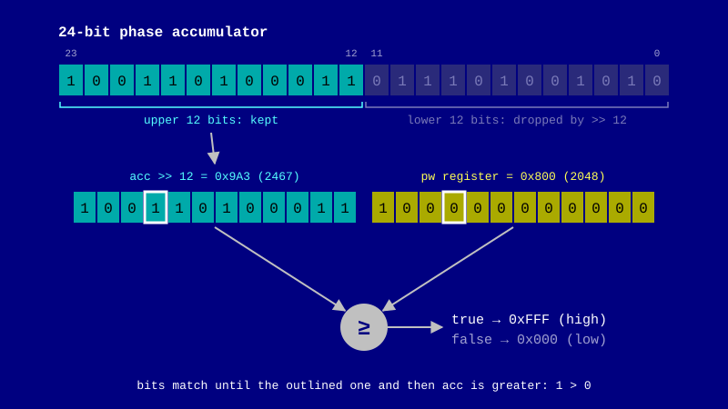

+++
author = "Yiğit Kolat"
title = "Notes around SIDOsc (1)"
date = "2026-10-25"
description = "Pulse Width Modulation in Commodore 64's SID chip"
type = "posts"
draft = false
tags = []
+++

<br>

I spent quite a bit of my childhood in front of a Commodore 64, and one sound always stuck with me. It created this sensation of thinning out and thickening again while keeping the same pitch. Listen to the opening of Wally Beben's `Dark Side` (1988/89) for a classic example:
<br>

<div style="max-width: 560px; margin: 1.5em auto;">

</div>

<br>

I'd hiss air through my teeth while sweeping my palm back and forth in front of my face to imitate it. Years later, while working on [SIDOsc](https://github.com/hayakzan/SIDOsc), I finally got to catch some insight about how this worked. 

<br>

## Pulse width

<br>

A pulse wave only ever has two values: high and low. It jumps between them once per cycle. We can shape how long the wave stays high relative to how long it stays low. That ratio is the `duty cycle`. Below, you can change the duty cycle using the slider and hear how it changes the sound.

Note: this is a clean pulse wave generated by your browser, just to hear duty cycle and PWM. The real chip adds its own character with its analog quirks that you won’t hear here.

<div data-pulse-duty-wave></div>
<script src="pulse-duty-wave.js"></script>

<br>

Since cycle length doesn't change, the frequency stays the same. Only the ratio between the high and low parts changes. At 50% we get a hollow square wave. As the duty cycle moves toward either extreme, the sound gets thinner and more nasal.

As we see in the Beben example, C64 musicians often preferred to sweep the pulse width value continuously while playing a tone. That’s pulse width modulation (PWM), and it’s the source of the timbre that got etched into my brain. Click `Sweep` button in the above example to try it out. 

It’s worth looking at how the SID actually pulls off this trick.

<br>

## How does the SID do it?

<br>

The SID doesn't have a separate pulse oscillator. It reuses the same 24-bit phase accumulator that drives every waveform, and compares only the accumulator's upper 12 bits against the 12-bit pulse width register. From the reSID source:

```c

    pulse_output = (accumulator >> 12) >= pw ? 0xfff : 0x000;
    
```
<br>

Shifting right by 12 drops the lower bits and leaves only the upper 12. The pulse width register `pw` acts as a threshold. When those upper 12 bits are greater than or equal to it, the output is `0xfff` (the 12-bit max). Otherwise it's 0.



<br>

That one comparison is the whole pulse oscillator. As the accumulator ramps up through each cycle, the output flips from low to high at the point where it crosses `pw`. Move `pw` and you move that point, and with it the duty cycle. Note the direction: a larger `pw` makes the high part shorter.

<div data-sid-pulse-phase></div>
<script src="sid-pulse-phase.js"></script>

<br>

So that’s what I was chasing with my hand in front of my face -- one number sliding up and down while the tone keeps playing. 

<br>
